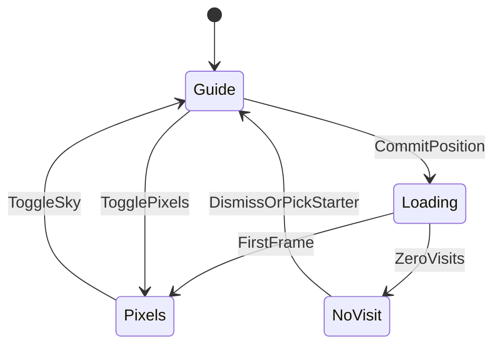

# SPHEREx sky explorer

A Vite + React + TypeScript app in the empty [README.md](README.md) repo, plus a small Python fetcher. No Tailwind, no account server. Material Web for controls; custom pieces only where Material Web cannot draw the sky, the timeline, or the marker.

## Chrome

Tokens in [src/theme/tokens.css](src/theme/tokens.css), shared with Material Web (`--md-sys-color-*`):

- Surface `#0E0E10`, surface container `#1A1A1E`, outline `#44444A`, on-surface `#F4F4F6`
- One UI accent, `#A8C7FA`, for the selected segment, focus, and the camera FAB
- Pattern IDs are the only other saturated marks. Fixed set, never the UI blue: coral `#FFB4A2`, gold `#F6E27A`, green `#80ED99`, pink `#FF8FAB`, apricot `#FFD6A5`, plus three more from that warm/green family
- The guide map and the detector frames keep their own scientific grayscale. Difference images are neutral gray (dark = negative, light = positive) so dipoles do not fight Pattern ID colors
- Roboto (Google Sans is not an open webfont). Shape: 28dp inner corners on the rail and FAB container, 16dp on cards and buttons. Dark elevation is tonal surface steps, not drop shadows

## Layout (844×390 and 915×412)

Edge-to-edge left rail, about 240px, always visible. The sky fills the rest. Portrait under 500px tall shows a rotate prompt.

The rail is the whole entry. Nothing is behind a mode switch:

- City field, focused by default, matched to a built-in lat/lon list. An unknown name gets a plain message. No geocoding API
- Use my location, beside the city field (browser geolocation only)
- Decimal RA and Dec, each with a one-line hint
- Drag the map stays available; the center is the aim point
- Patch size: three stops (tight / medium / wide), in plain language
- Inspect here commits the aim point

Zenith: latitude = Dec, local sidereal time = RA. Same formula for a city and for geolocation.

After a commit (Inspect, a city, coordinates, geolocation, or a starter), the analysis cluster fades onto the sky stage:

- Top-left 4-way Material segmented button: Time Blink, Subtract, Spectrum Bands, Signal & Noise. Icon + plain name. The active mode’s one-line explanation is always visible (phones have no hover). Inactive modes use a tooltip with the same kind of sentence
- Under it, only that mode’s sliders and switches, still labeled
- Bottom-left card: coordinates, epoch span, Pattern ID legend
- Bottom-right extended FAB: camera icon and “Snapshot”
- A Community text button in the rail opens the same gallery

## Guide map to pixels

[src/sky/GuideMap.tsx](src/sky/GuideMap.tsx) uses chromeless Aladin Lite on the unWISE color HiPS. Caption: this is an infrared guide map, not the SPHEREx exposure. A transparent canvas draws starter tracks and, later, the user’s patterns.

Fetcher in [server/spherex.py](server/spherex.py) (FastAPI, astropy, astroquery). The browser cannot reliably read IRSA. Vite proxies `/api`.

- `GET /api/visits` runs the IRSA TAP query and returns real visit times and bandpasses, before pixels exist
- `GET /api/frames` downloads a capped set of cutouts (about six epochs in each band group), caches them, and returns a stretched preview plus float32 values, variance/flags, wavelength, time, and a simple WCS summary
- Cutouts stay in spacecraft orientation. A north mark from the WCS is drawn. We do not secretly rotate them into a fake photo

Band groups, from SPHEREx’s own detectors:

- Hot stars: D1–D2, about 0.75–1.6 μm
- Cold icy objects: D4–D6, about 2.4–5.0 μm
- Time Blink only cycles frames inside the selected group, in time order. It does not flip through wavelengths and call that motion
- Subtract is the current epoch minus the first epoch in that group, from the float arrays

On-screen sequence in [src/sky/LoadSequence.tsx](src/sky/LoadSequence.tsx):

1. The guide map stays up. A visit timeline grows one real date at a time. Caption: “Finding visits…” then “Opening detector frames…”
2. Controls are already visible. Their lines say what they are waiting for (“Need a second visit to blink”)
3. When the first frame can be drawn, the view crossfades to the detector image and the Sky / Pixels toggle selects Pixels. One sentence: this is one SPHEREx wavelength slice; the grain is noise, not stars
4. The toggle remains: Sky map returns to the HiPS view, Pixels returns to the frame. This is the durable switch, so “see the map again” is not a hidden hold
5. The reticle shows a pixel value, the band, and a plain reading only after the numbers exist
6. The first time Subtract turns on, still stars fade off in a short crossfade, then the difference stays
7. If TAP returns nothing, the map stays, the timeline says SPHEREx has not visited this spot, and the starters are still one tap away

Signal & Noise: a contrast slider restretches the float array on the client. The artifact switch masks pixels the MEF flags or whose variance is unusable, and says that it did.

## Starters

Eight seeded posts, one set for the map and the gallery. Plain description first, catalog name second. All eight sit on the map as quiet marks; one is highlighted and labeled, and the highlight advances every few seconds. Clicking one commits that position.

Motion gets a short real track. Variables get a pulsing node, not a fake travel line.

- Vesta — “A dot that crossed this patch.” Fixed RA/Dec at a dated passage checked against a public ephemeris while building, not “wherever Vesta is today”
- Algol — “A star that dims on a schedule”
- 61 Cygni — “A nearby star that drifts”
- Sirius — “A bright star with a leftover we don’t agree on.” Real cutout only; seeded comments disagree. No painted glitch
- WISE 0855 — “A faint object that races” (08h55m10.831s, −7°14′42.53″)
- Barnard's Star — “A nearby star that slides quickly”
- RW Aurigae — “A star that flares and fades”
- Epsilon Indi B — “A dim neighbor beside a bright star”

## Marker, snapshot, gallery

A visible Mark path control uses pointer events (mouse and touch). Each tap stores the epoch on screen and the pixel. Nodes connect in time order, take the next Pattern ID color, and report direction, pixel shift, arcseconds when the WCS scale exists, and leftover brightness in the frame’s own counts when Subtract is on.

Snapshot stores a PNG plus the exact state: mode, epoch range, subtract, band, Sky/Pixels, RA/Dec, patch size, and pattern coordinates. The gallery is an iNaturalist-style drawer: image, fictional observer, place, date, plain title, comments. A line at the top says it is a demo and that new snapshots stay on this device. “How this view was made” expands on the card. Overlays can be turned off without losing that state. Comments append in `localStorage`. Opening a card recommits its saved position and fetches SPHEREx again. Card thumbnails are HiPS cutouts of the guide map, labeled as the guide.

The view’s RA/Dec and the committed analysis state are written to the query string so a refresh and a reopened post land on the same spot.

## Check

Run the fetcher and Vite, then in a browser at 915×412 and 844×390: city and a typed RA/Dec, one starter, the timeline, Sky/Pixels, blink, subtract, both bands, the stretch slider, a two-epoch marker, a snapshot, a comment, and a position TAP says has no visit.

## Build order

1. Scaffold Vite React TS, M3 tokens, Material Web theme, and the landscape shell with the left input rail
2. Add the FastAPI SPHEREx fetcher: TAP visits, cached cutouts, hot/cold groups, preview plus float32 and flags
3. Wire chromeless unWISE HiPS, starter tracks, and the commit/zoom flow
4. Build the visit timeline, captions, Sky/Pixels toggle, and the first-frame crossfade including the no-visit state
5. Implement Time Blink, Subtract, Spectrum Bands, and Signal & Noise on the float arrays, with always-visible plain copy
6. Add the marker, Pattern IDs, metrics, snapshot FAB, and the local demo community gallery
7. Exercise the landscape flows in the browser, including a position with no SPHEREx visit
